# Управління USB-пристроями та udev-правила для апаратури радіомоніторингу

Практична робота: ідентифікація, жорстка прив'язка й налаштування прав доступу для SDR-приймача (RTL-SDR) та USB-UART адаптера в ОС Linux за допомогою підсистеми **udev**.

**Середовище:** Windows 11 + WSL2, Debian 13 (trixie); USB-пристрої прокинуто через `usbipd-win`.
**Обладнання:** RTL-SDR донгл (RTL2832U + тюнер FC0012, `0bda:2838`).

## Зміст

- [Структура репозиторію](#структура-репозиторію)
- [Етап 0. Підготовка WSL](#етап-0-підготовка-wsl)
- [Етап 1. Ідентифікація обладнання](#етап-1-ідентифікація-обладнання)
- [Етап 2. Блокування DVB-драйверів](#етап-2-блокування-dvb-драйверів)
- [Етап 3. udev-правила](#етап-3-udev-правила)
- [Етап 4. Застосування без перезавантаження](#етап-4-застосування-без-перезавантаження)
- [Етап 5. Скрипт check_hardware.py](#етап-5-скрипт-check_hardwarepy)
- [Розгортання на чистій Ubuntu/Debian](#розгортання-на-чистій-ubuntudebian)

## Структура репозиторію

```
.
├── config/
│   ├── 99-radio-monitor.rules   # udev-правила  -> /etc/udev/rules.d/
│   └── blacklist-sdr.conf       # blacklist DVB -> /etc/modprobe.d/
├── check_hardware.py            # скрипт валідації обладнання
├── ls_output.log                # лог створення символічних посилань
├── images/                      # скриншоти виконання
└── README.md
```

---

## Етап 0. Підготовка WSL

### 0.1. Увімкнення systemd

Без systemd у WSL не запускається `systemd-udevd`, і правила не спрацюють. У файл `/etc/wsl.conf` додано:

```ini
[boot]
systemd=true
```

Після цього потрібно виконати `wsl --shutdown` у PowerShell і перевірити, що udev працює:

```bash
systemctl status systemd-udevd
```

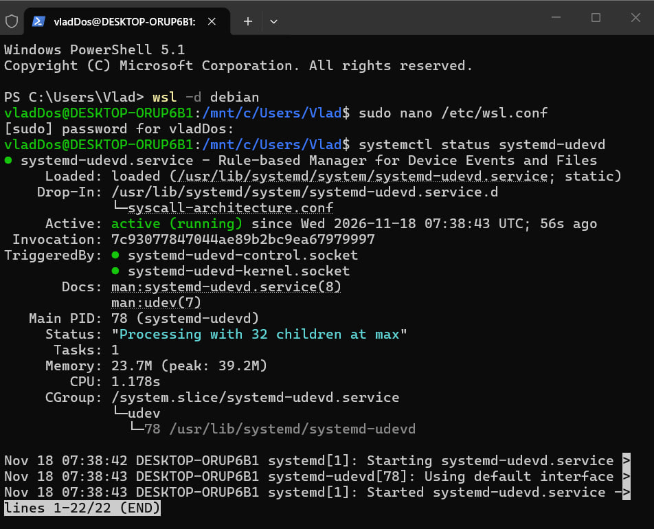

### 0.2. Встановлення пакетів у Debian

```bash
sudo apt update
sudo apt install usbutils python3-serial rtl-sdr
```

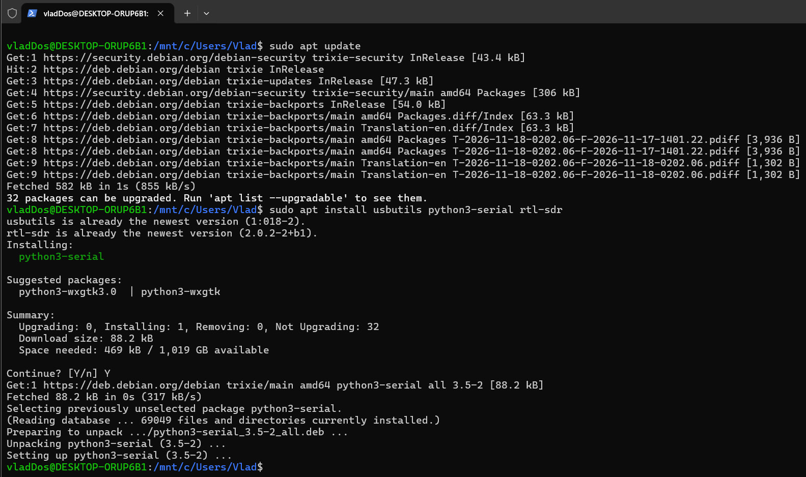

Підключення SDR-приймача до ноутбука:

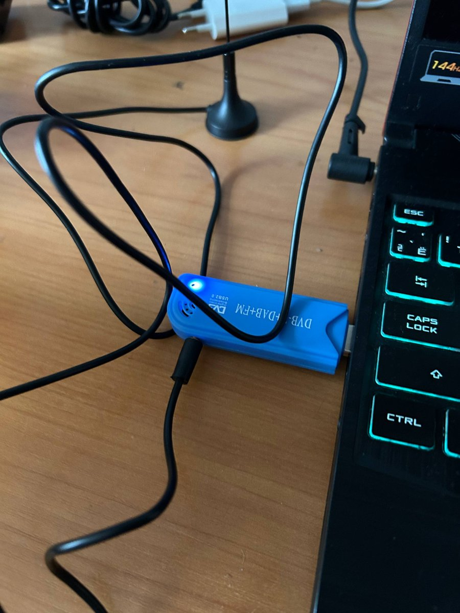

### 0.3. Встановлення usbipd-win у Windows

У PowerShell від адміністратора:

```powershell
winget install usbipd
```

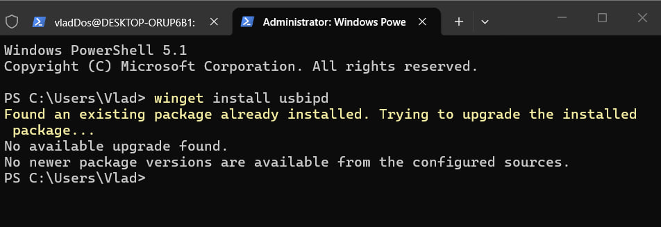

### 0.4. Прокидання пристрою у WSL

Підключаємо SDR і в PowerShell (адмін) виконуємо:

```powershell
usbipd list                          # знаходимо BUSID приймача (0bda:2838 -> 1-2)
usbipd bind --busid 1-2              # за наявності USBPcap: usbipd bind --force --busid 1-2
usbipd attach --wsl --busid 1-2
```

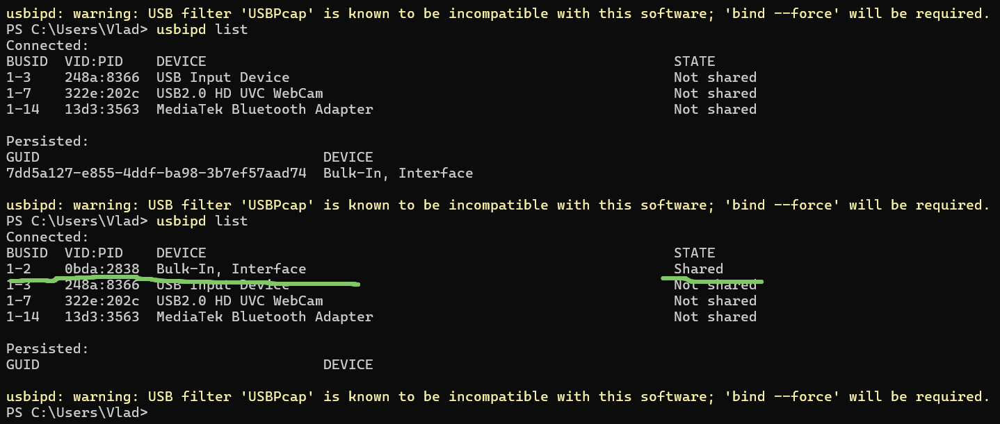

> `bind` робиться один раз. `attach` доведеться повторювати після кожного перепідключення пристрою або перезапуску WSL.

---

## Етап 1. Ідентифікація обладнання

```bash
lsusb
sudo dmesg | tail -30
```

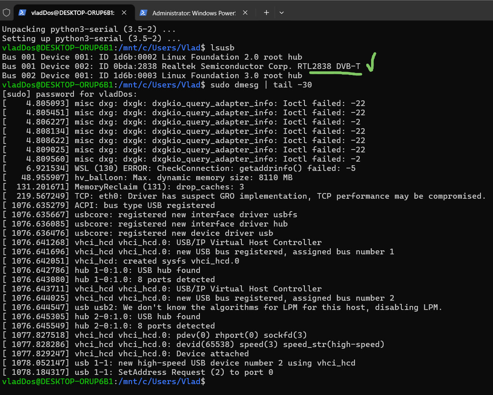

На відміну від USB-UART, RTL-SDR не створює `/dev/ttyUSB*`. Програми звертаються до нього напряму через libusb, а сам пристрій лежить у `/dev/bus/usb/<шина>/<пристрій>`:

```bash
ls -l /dev/bus/usb/001/002
```

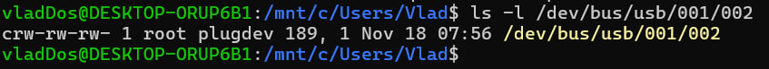

SDR не створює tty, тому атрибути дивимось через вузол USB (номери шини й пристрою беремо з `lsusb`):

```bash
udevadm info -a -n /dev/bus/usb/001/002 | grep -E 'idVendor|idProduct|serial' | head
```

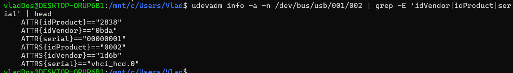

Беремо перші три рядки, бо вони належать самому SDR. Решта (`1d6b:0002`, `vhci_hcd.0`) належить віртуальному USB/IP-контролеру.

| Параметр | Значення |
|---|---|
| Vendor ID (VID) | `0bda` (Realtek) |
| Product ID (PID) | `2838` (RTL2838 DVB-T) |
| Serial | `00000001` |

---

## Етап 2. Блокування DVB-драйверів

Створено файл [`config/blacklist-sdr.conf`](config/blacklist-sdr.conf) у `/etc/modprobe.d/`:

```
blacklist dvb_usb_rtl28xxu
blacklist rtl2832
blacklist rtl2830
blacklist r820t
```

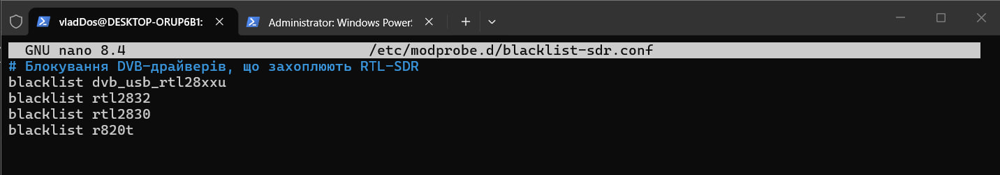

У WSL ядро від Microsoft, і цих модулів у ньому найчастіше просто немає. Перевірити можна командою `modinfo dvb_usb_rtl28xxu`: якщо отримуємо "not found", то конфлікту й так немає.

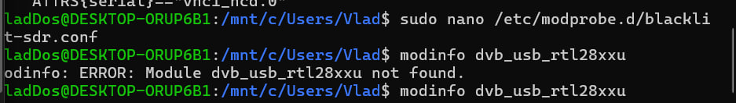

---

## Етап 3. udev-правила

Файл [`config/99-radio-monitor.rules`](config/99-radio-monitor.rules) у `/etc/udev/rules.d/`:

```
SUBSYSTEM=="usb", ENV{DEVTYPE}=="usb_device", ATTR{idVendor}=="0bda", ATTR{idProduct}=="2838", ATTR{serial}=="00000001", SYMLINK+="sdr_primary", MODE="0666"
```

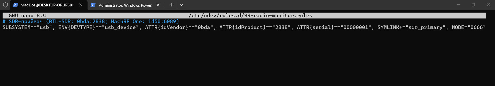

- `ENV{DEVTYPE}=="usb_device"` і `ATTR` (без S) потрібні, щоб правило спрацювало на сам пристрій, а не на кожен його інтерфейс.
- `ATTR{serial}` прив'язує ім'я до конкретного приймача.
- `MODE="0666"` дає доступ без `sudo` для Python і GNU Radio.

Правило для USB-UART адаптера (`/dev/uart_compass`) додано у файл як шаблон, бо під час виконання роботи адаптер не був підключений.

---

## Етап 4. Застосування без перезавантаження

```bash
sudo udevadm control --reload-rules && sudo udevadm trigger
sudo udevadm trigger --action=add
ls -l /dev/sdr*
```

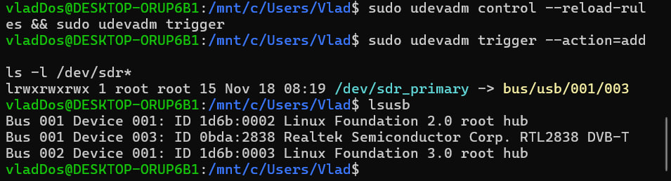

`/dev/sdr_primary` вказує на `bus/usb/001/003`: після перепідключення приймач отримав новий номер пристрою (був `002`), а постійне ім'я udev переприв'язав автоматично. Саме це і є метою роботи.

Лог для захисту ([`ls_output.log`](ls_output.log)) і перевірка приймача через `rtl_test`:

```bash
ls -l /dev/uart* /dev/sdr* | tee ls_output.log
rtl_test
```

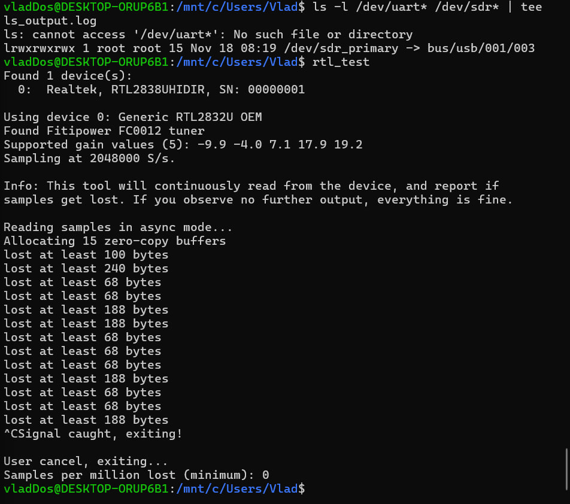

`rtl_test` знаходить приймач (`SN: 00000001`, тюнер FC0012) і читає семпли. Поодинокі `lost at least N bytes` пояснюються затримками USB/IP у WSL.

---

## Етап 5. Скрипт check_hardware.py

Скрипт [`check_hardware.py`](check_hardware.py) перевіряє наявність символічних посилань і права доступу, а за наявності компаса читає з його порту тестові байти. Запускаємо **без sudo**, бо саме це й перевіряє, що `MODE="0666"` працює:

```bash
python3 check_hardware.py
```

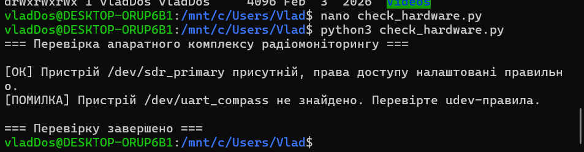

**Результат:**
- `/dev/sdr_primary`: `[ОК]`, пристрій присутній і права налаштовані.
- `/dev/uart_compass`: `[ПОМИЛКА]`. Помилка виникає, бо підключено лише SDR, а USB-UART адаптер відсутній.

---

## Розгортання на чистій Ubuntu/Debian

```bash
# 1. Пакети
sudo apt update
sudo apt install usbutils python3-serial rtl-sdr

# 2. Blacklist DVB-драйверів
sudo cp config/blacklist-sdr.conf /etc/modprobe.d/
sudo update-initramfs -u

# 3. udev-правила (попередньо підставте свої VID/PID/serial)
sudo cp config/99-radio-monitor.rules /etc/udev/rules.d/

# 4. Застосування без перезавантаження + перепідключити пристрої
sudo udevadm control --reload-rules && sudo udevadm trigger --action=add

# 5. Перевірка
ls -l /dev/uart* /dev/sdr*
python3 check_hardware.py
```

> **Для WSL2** додатково: увімкнути `systemd=true` у `/etc/wsl.conf` і прокинути пристрої через `usbipd-win` (див. [Етап 0](#етап-0-підготовка-wsl)). Крок `update-initramfs` у WSL не потрібен.
